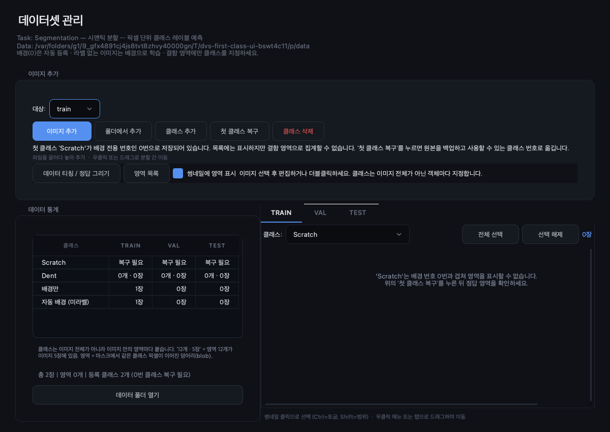
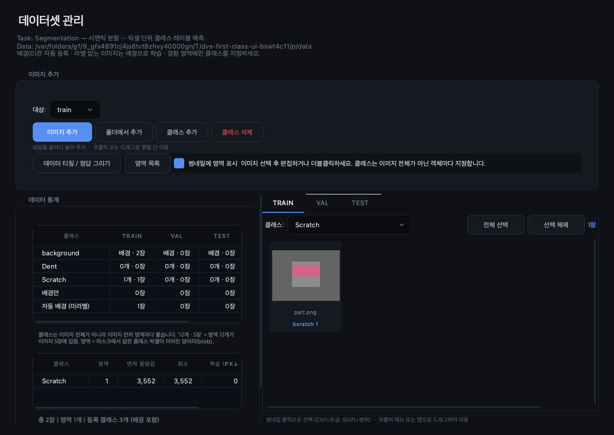
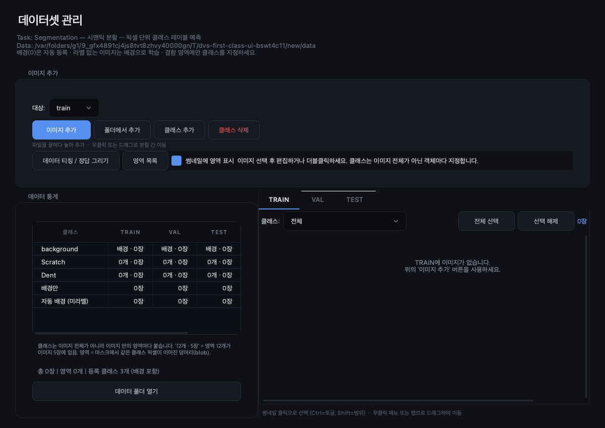

# 데이터셋 첫 클래스 누락 — 원인 및 검증

## 원인

`DatasetWidget`이 전경 편집용 `region_classes()`를 통계·필터 구성에도 사용했다.
이 함수는 semantic ID 0을 그리지 못하게 `names[1:]`을 반환하므로, 새 프로젝트의 배경뿐 아니라
구형 프로젝트의 첫 결함 이름까지 화면에서 사라졌다. 9.43은 생성과 복구 경로를 고쳤지만 이 표시 경로를 놓쳤다.

## 수정

등록 목록 표시는 모든 이름을 사용한다. 전경 편집·삭제는 여전히 배경을 제외한다.
첫 이름이 배경과 겹친 구형 프로젝트에는 이름과 `복구 필요`를 표시하고, 복구 전에 배경 픽셀을 결함으로 세지 않는다.
배경 필터는 실제 배경 픽셀이 있는 이미지 및 미라벨 자동 배경 이미지에 적용한다.
표시만으로 저장 파일은 바꾸지 않으며, 복구 후 같은 이름의 필터를 유지한다.

## 검증

- 수정 전 새 회귀 테스트: **6 실패, 1 통과**. 새 배경 행 1건, 배경 이름 변형 3건, 구형 첫 클래스 2건에서 누락 재현.
- 수정 후 새 회귀 테스트: **7 통과**. 구형 프로젝트 저장·재개, 실제 복구 버튼의 작업 스레드, 원본 파일 보존,
  복구 후 영역 통계와 필터 유지, 오류/255/전경-only 마스크, 탐지 ID 0을 포함한다.
- 실제 Qt 화면의 비동기 스캔 및 복구 버튼 실행 후 아래 화면을 캡처·확인했다.
- 전체 Python 테스트: **1,196 통과, 12 건너뜀**, 149.32초. 로그 `/tmp/dvs-first-class-all.log`,
  JUnit `/tmp/dvs-first-class-all.xml`. 이 실행에 새 회귀 테스트 7개와 기존 데이터셋·라벨링 테스트가 포함된다.
- 수정 파일 Ruff E/F/W 검사와 `git diff --check` 통과.

## 경계

macOS에서 Qt offscreen으로 실행했다. Windows 실기 UI 확인은 하지 않았다.
사용자 검사 데이터나 실제 프로젝트 파일은 제공받지 않았으며 생성 데이터로 검증했다.
평면 마스크의 값 0만으로는 과거 결함 경계를 복원할 수 없다. 기존 복구 기능은 저장된 편집 이력/폴리곤만 복구하며
경계 정보 없는 0번 픽셀은 유지한다. 학습·ONNX·추론 코드는 이번 수정에서 변경하지 않았다.
