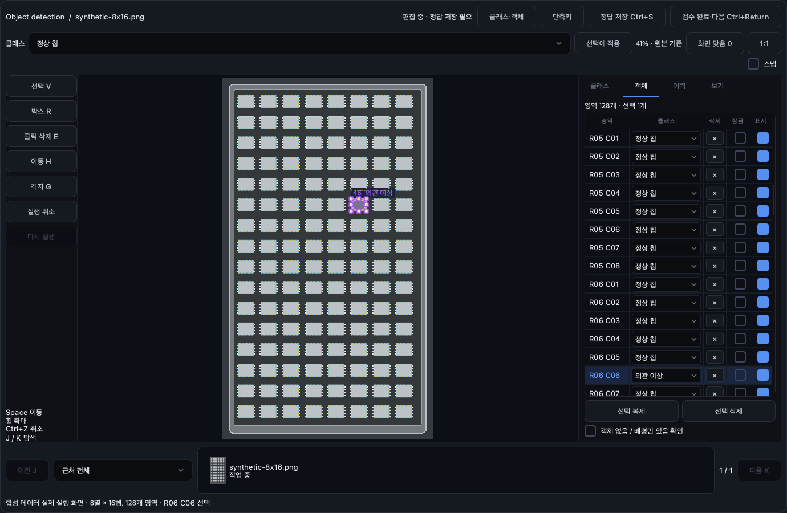

# 라벨링 작업실

데이터셋에서 이미지를 선택한 뒤 **데이터 티칭 / 정답 그리기**를 누르거나 이미지를 더블클릭한다. Object detection과 Segmentation의 모든 기본 모델은 같은 편집기를 사용한다. 모델을 바꿔도 도구와 클래스 편집 방식은 같다.

## 화면



[Segmentation 실제 실행 화면](02-design/assets/annotation-workspace-segmentation.png)

왼쪽은 도구, 가운데는 원본 이미지, 오른쪽은 클래스·객체·이력·보기 패널이다. Segmentation에는 로컬 AI 패널도 있다. 작은 창에서는 오른쪽 패널을 접으며 위쪽 **클래스·객체** 버튼으로 다시 연다. 도구와 속성은 작은 화면에서도 스크롤할 수 있다.

아래에는 현재 이미지 주변 최대 21장의 썸네일과 상태 필터가 있다. 프로젝트 전체 목록과 필터는 데이터셋 화면에서 사용한다. 저장한 검수 이력은 원본 이미지·클래스·라벨 revision이 맞을 때 표시한다.

클래스는 그림을 그리기 전에도 **클래스 → 클래스 추가**에서 등록한다. Segmentation의 ID 0은 배경이고, `학습 제외 영역 (255)`는 별도 항목이다.

## 기본 조작

| 작업 | 기본 키 / 조작 |
|---|---|
| 선택 | V. Shift+클릭 또는 빈 공간 드래그로 여러 영역 선택 |
| 박스 / 다각형 | R / P. 다각형은 Enter 또는 첫 점 클릭으로 완료 |
| 꼭짓점 | 드래그 이동, 변 더블클릭 또는 우클릭 메뉴로 추가, Alt+Delete로 선택 점 삭제 |
| 브러시 | B. 원형/사각형, 원본 픽셀 단위 크기. `[` `]`로 크기 변경 |
| 지우기 | E. 브러시 중 Shift를 누르면 임시 지우개 |
| 채우기 | F. 연결 영역을 미리 본 뒤 제안 적용 또는 Enter |
| 이동 / 확대 | Space+드래그 또는 가운데 버튼 / 커서 위치에서 휠 |
| 화면 맞춤 / 원본 1:1 | 0 / Ctrl+1. 표시 배율은 장치의 픽셀 배율을 반영 |
| 실행 취소 / 다시 실행 | Ctrl+Z / Ctrl+Y 또는 Ctrl+Shift+Z |
| 복제 / 삭제 | Ctrl+D / Delete. 여러 선택은 한 번에 적용 |
| 표시 숨김 | O. 보기 패널의 밝기·대비는 화면에만 적용 |
| 정답 저장 | Ctrl+S. 창을 닫지 않음 |
| 검수 완료 후 다음 | Ctrl+Enter |
| 이미지 이동 | J / K 또는 아래 탐색 버튼 |

**단축키** 버튼에서 원하는 키로 바꿀 수 있다. 입력란의 문자 편집은 영향을 받지 않는다. Space·Enter·Esc·클래스 숫자키·브러시 크기 키는 고정이다. 그리는 중 Ctrl+Z는 최근 점이나 진행 중 획을 취소한다. Esc는 그리는 작업 또는 제안을 취소하고 편집창을 닫지 않는다.

## 브러시와 지우개

- 브러시로 그린 부분도 이미지에서 클릭 선택할 수 있다. 같은 클래스의 선택 영역에 이어 그리면 같은 영역으로 묶는다. 따로 만들 때는 **새 영역**을 누른다.
- 지우기 기본 범위는 **선택 영역**, 선택이 없으면 **활성 클래스**다. 활성 클래스만 또는 전체 편집 가능 영역으로 바꿀 수 있다.
- 잠긴 영역은 덮어쓰기·삭제·클래스 변경에서 보호한다. 숨김은 화면 표시만 바꾸고 학습 마스크는 그대로 유지한다.
- 지운 부분은 배경 0이 되어 원본 이미지가 보인다. 흰색 획이나 전경 영역을 새로 더하지 않는다.
- 255 영역은 일반 지우기에서 보호하며, 해당 영역을 명시적으로 선택하거나 학습 제외 항목을 활성화했을 때 수정한다.
- 가져온 PNG는 클래스별 픽셀 영역으로 선택·지우기·클래스 변경할 수 있다. 원래 없던 객체 경계를 복원했다고 간주하지 않는다.
- 떨어진 부분을 각각 편집하려면 객체 패널의 **선택 영역의 연결 부분 나누기**를 사용한다. 노란 윤곽을 확인한 뒤 적용한다. 클래스와 마스크 픽셀은 그대로이며, 구멍을 채우지 않는다. 전체 분리를 한 번에 실행 취소할 수 있다.

## 8열 × 16행 칩

1. 첫 칩의 박스 또는 영역을 만들고 선택한다.
2. **격자 G**를 누른다. 기본값은 8열·16행이다.
3. **가로 마지막 칩 중심 찍기**, **세로 마지막 칩 중심 찍기**를 누르고 원본 이미지에서 기준점을 찍는다. 기울기를 포함해 배열을 맞춘다.
4. 원근이 있으면 4점 보정을 켜고 대각 마지막 칩의 중심도 찍는다.
5. 미리보기에서 범위 밖 칸, 누락 칩, 복제하지 않을 칸의 체크를 해제한다.
6. 적용한다. 기본값은 기준 영역을 포함한 후보로 교체하며, 전체 작업을 한 번의 Undo로 되돌린다.

미리보기 중 원본 영역을 바꾸면 적용을 중단하고 다시 열도록 안내한다. 일반 Detection은 축 정렬 박스이고, 회전 검출 모델을 새로 추가하는 기능은 아니다. 슬롯 분류용 ROI와 실제 칩 검출 박스의 목적을 구분해 라벨링한다.

## 저장·초안·복구

자동 초안은 학습 정답을 바꾸지 않는다. 미완성 다각형도 초안으로 보존한다. 재시작 후 호환되는 초안이 있으면 복원/버리기를 선택한다. 원본·정답·클래스가 달라진 초안은 자동 적용하지 않는다.

**정답 저장**은 현재 결과를 학습용 TXT 또는 PNG로 확정한다. **검수 완료·다음**은 검수 이력을 추가하고 다음 이미지로 이동한다. 이미지를 보기만 하고 이동하면 새 빈 정답을 만들지 않는다. 정상 이미지는 `객체 없음 / 배경만 있음 확인` 후 저장하거나 명시적으로 검수 완료한다.

저장 도중 수정한 내용은 저장된 것으로 표시하지 않는다. 저장에 실패하면 창과 변경 내용을 유지한다. 외부에서 정답이나 원본 이미지가 바뀌면 덮어쓰기를 거부한다. 저장은 원자적 파일 교체와 프로젝트 복구 저널을 사용한다. 중단된 저장은 다음 데이터 탐색/편집 전에 이전 확정 파일로 복구한다.

기존 TXT·PNG는 그대로 읽는다. 새 PNG도 일반 이미지 프로그램과 학습 로더에서 읽는 클래스 번호 PNG다. 편집 정보 v2를 이해하지 못하는 웹 편집기는 정확한 픽셀을 읽기 전용으로 보여준다. 새 편집 정보의 수정은 데스크톱 작업실에서 계속한다.

## 로컬 SAM2

1. AI 패널에서 번들 Hiera 변형과 자동/GPU 또는 CPU 실행을 선택한다.
2. AI 점에서는 왼쪽 클릭이 포함점, 오른쪽 클릭이 제외점이다. AI 박스에서는 영역을 드래그한다.
3. 결과를 확인해 제안을 적용한다. 추가 점으로 다시 제안받거나 취소할 수 있다.
4. 적용한 뒤 브러시·지우개로 수정하고 정답을 저장한다.

이미지 임베딩은 같은 이미지에서 재사용한다. 결과는 사용자 확정 전 정답이 되지 않으며, 이미지 이동·수동 수정·취소 후 도착한 예전 결과는 적용하지 않는다. 모델은 `build.bat`으로 준비된 로컬 자산을 사용한다. 편집 중 가중치를 받거나 이미지를 업로드하지 않는다.

## 개발 환경에서 검증

앱과 같은 Python 환경에서 인자 없이 실행한다.

```bat
python tools\benchmark_annotation.py
python tools\verify_annotation_sam2.py
```

첫 명령은 합성 4096×4096/128개 객체에서 드래그와 획 확정을 측정한다. 두 번째는 번들 SAM2 Tiny로 실제 GUI 제안 → 적용 → 저장 → 재열기를 확인한다. 결과 JSON은 `local-artifacts/`에 저장한다. SAM2 검증에는 준비된 번들 가중치가 필요하며 이 명령이 다운로드하지 않는다.
