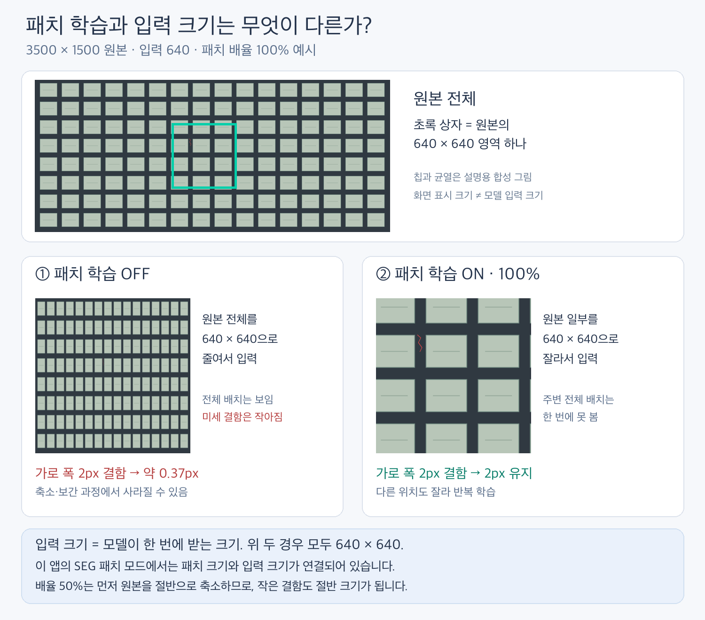

# 패치 학습과 입력 크기

**패치 학습은 원본을 잘라서 보는 방법이고, 입력 크기는 모델이 한 번에 받는 크기입니다.**



3500×1500 판정 영역, 입력 크기 640을 예로 들면:

| 설정 | 모델에 넣는 이미지 | 원본의 가로 폭 2px 균열 |
|---|---|---|
| 패치 OFF | 전체를 640×640으로 축소 | 약 0.37px 폭이 되어 흐려지거나 사라질 수 있음 |
| 패치 ON, 배율 100% | 원본에서 640×640 영역을 잘라 입력 | 축소 전처리에 의한 크기 감소 없음 |
| 패치 ON, 배율 50% | 원본을 절반으로 축소한 뒤 640×640을 자름 | 약 1px 폭으로 감소 |

위 숫자는 전처리 공간에서의 크기입니다. 패치 100%여도 신경망 내부 다운샘플링까지 없애는 것은 아니며, 검출 정확도를 보장하지 않습니다.

```python
import cv2

# image와 mask는 같은 3500×1500 원본 좌표계라고 가정합니다.
# mask의 픽셀 값: 0=배경, 1부터 프로젝트 클래스, 255=학습 제외.

# 전체 학습
whole_input = cv2.resize(image, (640, 640))
whole_target = cv2.resize(mask, (640, 640), interpolation=cv2.INTER_NEAREST)

# 패치 학습 100%: 이미지와 정답을 반드시 같은 위치에서 자릅니다.
x, y = 1350, 430
patch_input = image[y:y+640, x:x+640]
patch_target = mask[y:y+640, x:x+640]
assert patch_input.shape[:2] == patch_target.shape == (640, 640)

# 실제 학습에서는 이후 증강·정규화·텐서 변환을 거쳐 모델에 넣습니다.
# RGB 1장이라면 모델 입력 텐서는 [1, 3, 640, 640]입니다.
```

현재 native SEG 코드에서는 두 설정을 독립적으로 입력하지 않습니다. `train_builtin.py`가 패치 ON일 때 **patch_size=input_size[0]**을 전달하고, `PatchSegmentationDataset`도 입력 크기를 이 패치 크기로 맞춥니다. 즉 입력 크기 640 → 패치 640입니다. 별도의 **패치 배율**은 자르기 전에 원본을 얼마나 줄일지 정합니다.

학습은 매 에폭 다른 위치에서 패치를 뽑으며 일부는 결함 주변, 일부는 임의 위치를 사용합니다. 검증은 전체를 덮는 고정 타일을 사용합니다. 추론은 저장된 타일·겹침 설정에 따라 처리한 결과를 원본 좌표로 합칩니다. 가장자리의 작은 영역은 패딩/끝 정렬로 처리합니다.

패치를 많이 뽑는다고 서로 독립적인 원본 이미지가 늘어나는 것은 아닙니다. **원본 단위로 Train/Val/Test를 먼저 나누고 패치를 만드세요.** 패치는 미세 결함 보존에 유리하지만 큰 물체 전체 배치를 한 번에 보기 어렵고, 원본 한 장의 총 추론 횟수도 늘어납니다.
