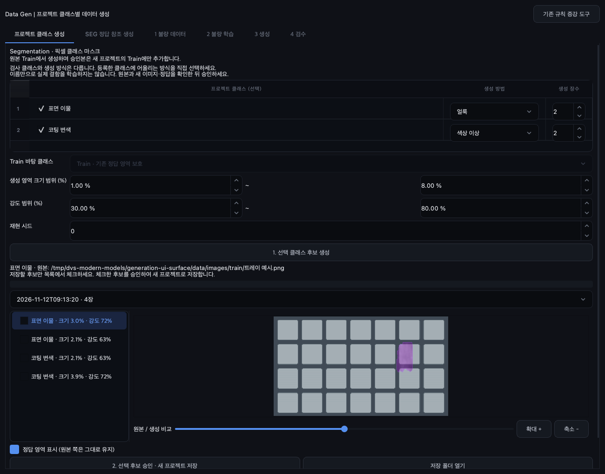

# 프로젝트 클래스별 이미지 생성

Data Gen → **프로젝트 클래스 생성** 탭에서 사용합니다. 예전처럼 특정 결함 이름을 클래스 목록으로 사용하지 않습니다. `project.data.class_names`에 등록한 이름을 읽습니다. SEG의 0번 배경은 생성 대상으로 나오지 않습니다. 검출의 0번은 일반 클래스이므로 선택할 수 있습니다.

1. 데이터셋 화면에서 검사할 클래스를 등록합니다.
2. Data Gen에서 생성할 클래스를 체크합니다.
3. 클래스마다 생성 방법과 장수를 지정합니다. 방법은 스크래치, 얼룩, 결손, 입자, 질감, 탄성 변형, 색상 이상입니다. 이 목록은 **클래스 이름이 아니라 이미지에 적용할 기법**입니다.
4. 분류는 바탕으로 쓸 Train 클래스도 선택합니다. SEG/검출은 Train 영상의 기존 정답 영역을 피해 합성합니다. 이상검출은 `train/good`를 사용합니다.
5. 크기·강도 범위와 시드를 지정하고 **선택 클래스 후보 생성**을 누릅니다. 범위 안에서 후보별 모양·위치·강도가 달라집니다.
6. 목록에서 후보를 고르고 원본/생성 슬라이더, 정답 영역 표시로 확인합니다. 실제 검사 클래스에 맞는 후보만 체크합니다.
7. **선택 후보 승인 · 새 프로젝트 저장**을 누릅니다. 저장 폴더를 열어 `.dvproj`를 실행합니다.

| 태스크 | 새 프로젝트에 저장하는 정답 |
|---|---|
| Classification | `data/train/<프로젝트 클래스>/generated-….png` |
| Segmentation | 새 이미지와 같은 이름의 클래스 ID 마스크. 기존 정답/ignore 영역 보존 |
| Object detection | 기존 박스 + 합성 영역을 둘러싼 YOLO 박스 |
| OBB | 기존 회전 박스 + 합성 영역을 둘러싼 회전 사각형 |
| Anomaly detection | 별도 **합성평가** 프로젝트의 `test/<클래스>`와 `ground_truth/<클래스>`. 불량을 정상 Train에 넣지 않음 |

분류/SEG/검출은 기존 Train/Val/Test를 복사하고 승인한 합성 영상만 새 Train에 추가합니다. 원래 프로젝트와 이미지는 수정하지 않습니다. 이상검출은 원본 정상 Train을 복사하고 합성 불량만 별도 평가용 Test에 넣습니다. 합성 시험 결과를 실제 시험 정확도로 해석하지 마세요.

후보와 원본 비교 자료는 `<프로젝트>/project_generation/batches`, 저장 프로젝트는 `project_generation/publications`에 남습니다. 앱을 다시 열어도 후보를 선택할 수 있습니다. 저장은 미리 보던 PNG를 그대로 사용하며 이미지를 다시 생성하지 않습니다. 클래스 목록 변경이나 후보 파일 변조는 저장 전에 검사합니다.

**생성 기법은 실제 결함의 의미를 자동으로 학습하지 않습니다.** 예를 들어 `핀 뒤집힘`을 등록했다고 물리적으로 뒤집힌 핀이 저절로 만들어지는 것은 아닙니다. 이런 결함은 **SEG 정답 참조 생성**의 배치·형상 보존 방식이나 학습형 Data Gen을 선택하고 실제 데이터로 검증하세요. 기존 참조 생성과 학습형 생성 탭도 유지했습니다.
