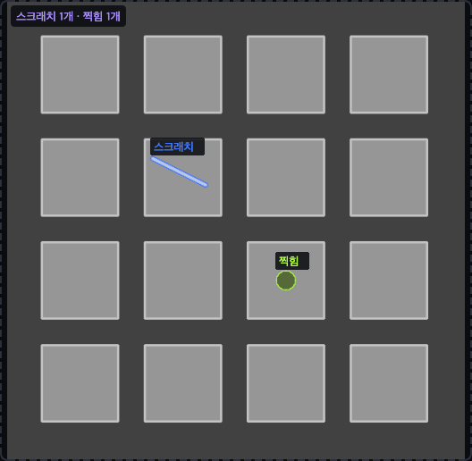

# 9.56 — 원본 위에 검출 영역 표시

추론 화면에서 분할 모델을 로드하고 실행하면 배경은 원본대로 보이고, 찾은 전경 영역만 클래스색/윤곽으로 표시한다. 영역 위에는 모델의 실제 클래스 이름이 붙는다. `클래스명` 체크로 이름을 숨길 수 있고 `원본 비교`로 원본을 나란히 본다. 확대·이동 시 이름도 영역 좌표를 따라간다. 배경만 예측하면 원본 그대로와 `검출 영역 없음`을 보여준다. 정답 라벨 없이도 예측 영역은 표시한다.

`모델 반응 (Grad-CAM)`은 검출 결과와 다른 시각화이므로 기본 해제한다. 선택해서 재추론하면 반응 맵을 별도로 볼 수 있다. IoU/Dice는 GT가 있을 때만 계산하는 평가 정보이며 표시 조건이 아니다. 영역 개수는 같은 클래스의 연결된 픽셀 묶음(8-connectivity) 기준이다. 작은 잡음이 매우 많아도 모든 마스크는 표시하지만 화면 이름은 큰 영역 256개까지 표시하고 제한 사실과 전체 개수를 안내한다.

새 결과/작업 기록에는 원본과 영역 위치를 함께 보존한다. 9.55 이전 캐시에 이미 색칠돼 저장된 그림을 복구하려면 다시 추론해야 한다. 재학습은 필요 없다. 모델 출력/가중치/학습/ONNX 내보내기는 변경하지 않았다.

참고한 동작: [Cognex Red Analyze — Review Markings](https://docs.cognex.com/deep-learning_320/web/EN/deep-learning/Content/deep-learning-Topics/training-red-foc-sup/marking.htm). 공식 설명의 defect outlines와 별도 heatmap/overlay 표시 구분을 참고했으며 제품 코드를 복제하지 않았다.

## 실제 표시 캡처

표시 검증용 합성 이미지에 알려진 예측 마스크를 주어 실제 Qt 추론 화면으로 렌더링했다. 실제 학습 모델의 검사 정확도나 처리 성능을 입증하는 그림은 아니다.

## 모델 점검 — 표시 수정과 구분

- U-Net ResNet18: 공식 가중치로 1ch/3ch 각각 합성 이미지 6/2장, 64×64, 2 epoch 학습→저장→재로드→추론→Qt 표시 실행. 기능 경로 확인이며 짧은 합성 학습 결과로 실제 정확도를 보장하지 않는다.
- SAM2: 일반 추론 체크포인트 해석기가 `SAM2 multi-graph checkpoint uses export_sam2_checkpoint`로 거부하는 연결 누락 재현. 현재 학습 목표도 prompt-conditioned binary mask이며 DeepLab과 같은 자동 semantic 클래스 분할이 아니다. 이 결함은 별도 해결이 필요하며 이번 수정으로 해결되지 않았다. 클래스를 임의로 붙여 동작하는 것처럼 만들지 않았다.
- 사용자 Windows 환경과 보안 검사 데이터에서는 미검증. U-Net에 대한 실제 실패 모델/단계/오류 문구를 요청한 상태다.

검증: 관련 회귀 110건 통과. 최종 전체 1244 passed, 12 skipped, exit 0. macOS에서 실행했으며 Windows 실기는 미검증이다.
