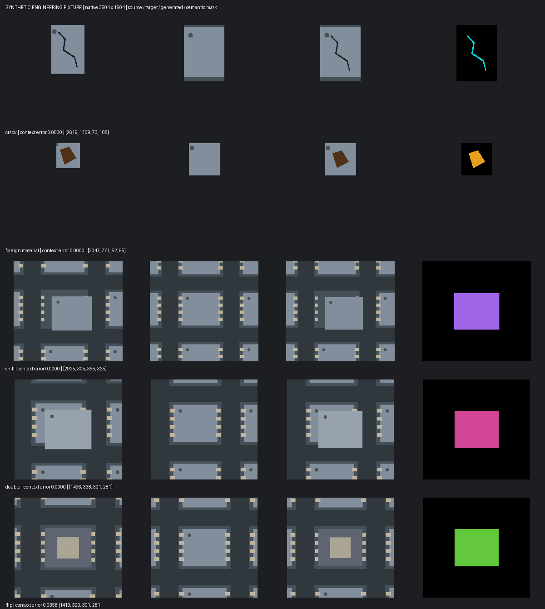

# SEG 정답 기반 가상 불량 생성 (14.86)

프로젝트의 실제 이미지와 세그멘테이션 정답에서 결함을 추출해 새로운 이미지와 **클래스 번호 마스크**를 함께 만든다. 별도 생성 모델·가중치·GPU·인터넷 연결이 필요 없다. 기존 LoRA Data Gen과는 별도 기능이다. 외부로 사진을 전송하지 않는다.

## 사용하는 순서

1. SEG 프로젝트를 열고 **Data Gen → SEG 정답으로 가상 불량**을 선택한다.
2. **프로젝트 정답 분석**을 누른다. Train/Val의 기존 마스크 PNG 또는 폴리곤 정답을 읽고 클래스별 사용 가능한 참조 수를 표시한다. 숫자에 마우스를 올리면 결함 면적과 문맥 크기가 보인다.
3. 생성할 클래스, 클래스별 수량, Train/Val, 시드를 선택한다. 방식이나 ‘정답 없는 사진도 정상 바탕으로’를 바꿨으면 다시 분석한다. 선택 클래스에 실제 참조가 없으면 생성하지 않는다.
4. **클래스당 1장 미리 생성**으로 먼저 확인하고 **설정 수량 생성**을 실행한다. 클래스당 최대 100장, 배치당 최대 500장이다.
5. 왼쪽은 합성할 바탕 원본, 가운데는 합성 결과, 오른쪽은 실제 결함 참조다. 마스크 표시를 끄면 원래 색상으로 확인할 수 있다. 휠 확대·드래그 이동·**결함 위치 확대**를 지원한다.
6. **정답 마스크 수정**에서 기존 SEG 드로잉 도구로 수정한다. 수정된 후보는 미검수로 돌아간다. 적절한 후보만 하나씩 승인하고 잘못된 것은 제외한다.
7. **승인본 포함 새 학습 프로젝트 저장**을 누른다. 저장된 폴더의 `SEG-synthetic.dvproj`를 앱의 프로젝트 열기로 연다. 원본 Train과 승인한 합성 Train, 원래의 Val/Test가 포함된다. 모델·패치·증강 설정은 복사하고 학습 이력은 새로 시작한다.

정상 사진에 빈 마스크가 있으면 바탕으로 사용할 수 있다. 정답 파일이 아예 없는 사진을 사용하려면 **정답 없는 사진도 정상 바탕으로**를 체크한다. 실제 불량인데 라벨링을 안 한 사진을 정상으로 넣으면 정답 오염이 생기므로 확인해야 한다.

## 클래스별 방식

| 기본 클래스 | 방식 | 보존하는 것 |
|---|---|---|
| crack / 균열 | 정상 표면을 추정한 뒤 실제 균열의 밝기·색상 차이를 이식 | 가느다란 형태, 원본 해상도. 1~2px급 얇은 결함은 축소·회전하지 않음 |
| foreign material / FM / 이물 | 실제 이물 형상·색상을 가져와 밝기를 맞춤 | 클래스 마스크와 외관. 제한된 각도·크기 변화 |
| shift / double / flip | 실제 불량과 주변 배치를 포함한 영역을 이식 | 위치 관계와 뒤집힌 외관. 회전·반전·크기 변형 없음 |
| 기타 사용자 클래스 | 기본은 배치·형상 보존 | 사용자가 균열 질감/이물 형상으로 바꾼 후 재분석 가능 |

단순히 이미지를 뒤집고 `flip` 정답을 붙이거나 두 칩을 아무 데나 겹쳐 `double`이라고 만들지 않는다. **실제로 라벨링한 불량의 모습을 재사용**한다. 연결이 끊어진 가까운 구조 결함은 함께 묶는다. 의미상 다른 결함이 너무 가깝거나 문맥이 이미지 밖으로 잘리면 해당 참조를 제외하고 이유를 표시한다. 인스턴스 정보가 없는 클래스 마스크에서는 가까운 영역의 묶음이 실제 한 불량과 일치하는지 검수해야 한다.

## 위치·크기·정답 규칙

- 출력은 바탕 원본과 같은 크기의 8bit RGB 또는 흑백 PNG다. 모델 입력 크기로 전체 영상을 축소하지 않는다.
- 빠른 위치 탐색에만 축소본을 쓰고, 최종 위치와 표면 차이는 원본 픽셀에서 확인한다.
- 원래의 결함 정답과 255 제외 영역에 합성하지 않는다. 원래 정답은 유지된다.
- 선택적으로 원본 크기의 허용 영역 PNG를 지정한다. 흰색 영역에만 합성한다. 구조 결함은 주변 문맥 전체가 허용 영역에 들어가야 한다.
- 표면 허용차가 작을수록 비슷한 주변 배치만 허용한다. 맞는 위치가 없거나 시각적 변화가 부족하면 실패 이유를 기록한다. 실패를 빈 불량으로 저장하지 않는다.
- 한 배치 안의 완전히 같은 결과는 중복 저장하지 않는다.
- `mask.png`는 배경 0 / 클래스 1…N / 제외 255인 **학습 정답**이다. `changed.png`는 실제로 바뀐 픽셀을 나타내는 별도 확인용 파일이다. 구조 문맥의 밝기 보정까지 불량 클래스로 만들지 않는다.

## Train / Val / Test 분리

Train 참조는 Train 바탕에만 합성하며 승인 후 새 학습 프로젝트로 저장할 수 있다. Val 참조는 Val 바탕에 합성하는 **검수용 후보**다. Val 후보의 학습 게시를 엔진과 UI 모두 막는다. Test는 참조 추출과 합성에 사용하지 않는다.

원본을 읽은 시점의 이미지·정답을 해시와 함께 별도 고정한다. 다른 이름/인코딩이라도 픽셀이 동일한 사진이 서로 다른 분할에 있으면 분석을 중단한다. 같은 로트의 비슷한 사진까지 자동으로 구분하지는 않으므로 로트별 분할은 사용자가 유지해야 한다. 클래스 이름/순서가 바뀌면 재분석한다. 과거 분석 기록은 보존하되 현재 클래스와 맞는 기록만 표시한다.

## 파일 위치와 복원

프로젝트 아래 `seg_synthesis/`에 저장된다.

- `profiles/<id>/`: 분석 시점의 이미지·정답·결함 참조, 출처와 해시
- `batches/<id>/samples/<id>/`: 원본, 합성 결과, 클래스 마스크, 변경 픽셀, 실제 참조
- `batches/<id>/manifest.json`: 시드, 합성 방식/변형/좌표, 표면 차이, 실패 사유, 검수 상태
- `publications/<id>/`: 승인본을 포함한 독립 학습 프로젝트와 데이터셋

**후보 폴더** 버튼으로 원본 크기의 결과를 확인할 수 있다. 재실행해도 후보와 승인/제외 상태가 복원된다. 취소/실패 중인 불완전한 분석·배치는 완료 기록에 포함하지 않는다. 원본 데이터는 수정하지 않는다. 새 프로젝트에는 전체 원본 데이터도 복사하므로 충분한 디스크 공간이 필요하다. 생성된 프로젝트를 다시 실제 결함 참조로 분석하는 반복 합성은 막는다.

## 확인 범위와 한계

이 기능은 실제 결함 예시를 활용하는 **참조 합성**이다. 수백 장으로 늘려도 서로 독립적인 실제 불량을 수백 개 확보한 것과 같지는 않다. 실제 불량 종류/방향/표면이 참조에 없으면 그 변동을 자동으로 학습해 만들지 않는다. 합성 데이터는 Train 보조 자료로 쓰고 성능은 합성되지 않은 실제 Val/Test에서 확인한다.

검증에는 자체 제작한 3504×1504, 8×16 트레이를 사용했다. 아래는 실제 사용자 데이터가 아닌 동작 확인 예시이며 정확도 향상을 의미하지 않는다.



재현 명령:

```bat
python tools\segmentation_synthesis_demo.py --output runs\seg-synthesis-demo
python -m pytest tests\test_segmentation_synthesis.py tests\test_segmentation_synthesis_ui.py -q
```

이 기능의 UI는 Windows 데스크톱 앱에 추가했다. React 웹 UI에는 새 화면을 추가하지 않았다. macOS에서 실제 Qt/작업 프로세스·학습·ONNX를 검증했으며 Windows EXE 실행은 로컬에서 검증하지 못했다. Windows 패키징 목록에 새 모듈을 포함했고 기존 Windows/Linux CI에서 회귀 테스트가 실행된다.
