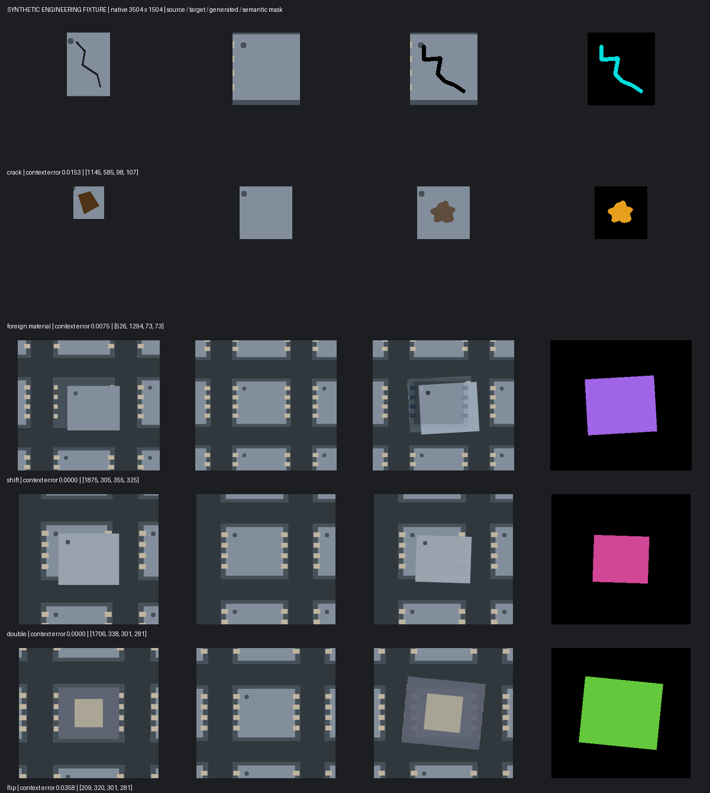

# SEG 정답 기반 가상 불량 생성 (16.89)

프로젝트의 실제 이미지와 세그멘테이션 정답에서 결함을 추출해 새로운 이미지와 **클래스 번호 마스크**를 함께 만든다. 별도 생성 모델·가중치·GPU·인터넷 연결이 필요 없다. 기존 LoRA Data Gen과는 별도 기능이다. 외부로 사진을 전송하지 않는다.

## 사용하는 순서

1. SEG 프로젝트를 열고 **Data Gen → SEG 정답으로 가상 불량**을 선택한다.
2. **프로젝트 정답 분석**을 누른다. Train/Val의 기존 마스크 PNG 또는 폴리곤 정답을 읽고 클래스별 사용 가능한 참조 수를 표시한다. 숫자에 마우스를 올리면 결함 면적과 문맥 크기가 보인다.
3. 생성할 클래스, 클래스별 수량, Train/Val, 시드를 선택한다. 방식이나 ‘정답 없는 사진도 정상 바탕으로’를 바꿨으면 다시 분석한다. 선택 클래스에 실제 참조가 없으면 생성하지 않는다.
4. 기본 **새 형상 생성**에서 크기·강도 범위와 형상 변화를 조절한다. **클래스당 1장 미리 생성**으로 먼저 확인하고 **설정 수량 생성**을 실행한다. 클래스당 최대 100장, 배치당 최대 500장이다.
5. 왼쪽은 합성할 바탕 원본, 가운데는 합성 결과, 오른쪽은 실제 결함 참조다. 마스크 표시를 끄면 원래 색상으로 확인할 수 있다. 휠 확대·드래그 이동·**결함 위치 확대**를 지원한다.
6. **정답 마스크 수정**에서 기존 SEG 드로잉 도구로 수정한다. 수정된 후보는 미검수로 돌아간다. 적절한 후보만 하나씩 승인하고 잘못된 것은 제외한다.
7. 사진을 파일로 받으려면 저장 범위(선택 후보/승인 전체/제외하지 않은 전체)를 선택하고 **이미지·정답 PNG 저장**을 누른다. 지정한 폴더 아래 새 폴더에 실제 합성 사진과 현재 정답 PNG를 저장한다. 화면의 색칠 표시·확대 상태는 저장 사진에 들어가지 않는다.
8. 바로 학습할 새 프로젝트가 필요하면 **승인본 포함 새 학습 프로젝트 저장**을 누른다. 저장된 폴더의 `SEG-synthetic.dvproj`를 앱의 프로젝트 열기로 연다. 원본 Train과 승인한 합성 Train, 원래의 Val/Test가 포함된다. 모델·패치·증강 설정은 복사하고 학습 이력은 새로 시작한다.

## 새로운 형상과 다양화

- **새 형상 생성**(기본): 균열 경로·가지를 새로 만들고 이물은 새 불규칙 윤곽을 만든다. 단순 회전·복사와 다르다. 색·명암·질감의 기준은 실제 참조에서 얻는다.
- **참조 형상 회전·크기 변형**: 기존 실루엣을 변형한다.
- **참조 형상 유지**: 실루엣은 그대로 두고 강도만 바꾼다.
- **크기** 35~300%: 참조 길이·폭 기준으로 후보마다 선택한다. 기본 65~145%다. 새 윤곽의 모양도 달라지므로 면적 비율을 뜻하지 않는다.
- **강도** 20~300%: 정상 표면 대비 밝기·색상 차이를 조절한다. 기본 60~150%다. 100%는 참조 수준이며 픽셀 범위는 0~255로 제한된다.
- **형상 변화** 0~100%: 균열 굽음·가지, 이물 윤곽의 불규칙성, 구조 결함 회전 정도를 조절한다.
- 시드를 바꾸면 다른 후보가 만들어진다. 같은 시드·설정으로 다시 실행하면 같은 환경에서 동일 후보를 재현한다. 저장은 현재 미리본 후보 그대로이며 저장 시 무작위로 바꾸지 않는다.

설정한 크기의 결함이 허용 영역에 들어가지 않거나 정상 표면과 맞지 않으면 제외 이유를 표시한다. 임의로 범위를 무시하거나 정답만 있는 빈 사진을 만들지 않는다.

정상 사진에 빈 마스크가 있으면 바탕으로 사용할 수 있다. 정답 파일이 아예 없는 사진을 사용하려면 **정답 없는 사진도 정상 바탕으로**를 체크한다. 실제 불량인데 라벨링을 안 한 사진을 정상으로 넣으면 정답 오염이 생기므로 확인해야 한다.

## 분석 후 참조가 0이거나 생성이 안 될 때 (14.87)

분석/생성의 진행 및 실패 문구는 표 위에 표시된다. **분석 상세 / 오류 보기**에서 실제로 읽은 이미지·마스크·폴리곤 폴더와 클래스별 정답/추출/제외 수를 확인한다. **내용 복사**로 텍스트만 전달할 수 있다.

- 정답 파일 0장: 표시된 마스크/폴리곤 폴더와 이미지의 상대 경로·파일명을 확인한다.
- 정답 파일은 있으나 불량 픽셀 0: 배경(0)/제외(255)뿐인 마스크인지 확인한다.
- 불량 픽셀은 있으나 사용 가능한 참조 0: 주변 다른 정답/테두리/문맥 부족별 개수를 확인한다. 복구 가능한 주변 문맥은 자동으로 줄여 추출한다.
- Train 0, Val에만 참조가 있는 경우: Val을 선택하면 사용 가능한 클래스가 체크된다. Val 합성본은 검수용이다.
- 데이터셋 화면이 스캔 중이면 분석이 잠시 기다린다. 기다리는 상태도 상단에 표시하며 중단할 수 있다.

실패 창에 구체적인 오류가 있으면 그 오류가 우선이다. 실패한 분석을 사용할 수 있는 것으로 표시하지 않는다. 같은 창의 **프로젝트 정답 분석**을 다시 실행해 복구하며 모델 재학습은 필요 없다.

## 클래스별 방식

| 기본 클래스 | 방식 | 보존하는 것 |
|---|---|---|
| crack / 균열 | 새 균열 경로·가지·두께에 실제 참조의 명암·색을 적용 | 최소 1px로 생성, 원본 해상도와 새 형상에 맞는 정답 |
| foreign material / FM / 이물 | 불규칙한 새 윤곽과 참조 색·질감으로 생성 | 클래스 마스크와 생성 외관이 함께 변경 |
| shift / double / flip | 실제 물체 배치를 단위로 크기·각도를 바꾸되 정상 주변은 유지 | 겹침 관계와 뒤집힌 외관. 다른 불량 종류로 임의 재분류하지 않음 |
| 기타 사용자 클래스 | 기본은 배치·형상 보존 | 사용자가 균열 질감/이물 형상으로 바꾼 후 재분석 가능 |

단순히 이미지를 뒤집고 `flip` 정답을 붙이거나 두 칩을 아무 데나 겹쳐 `double`이라고 만들지 않는다. **실제로 라벨링한 불량의 모습을 재사용**한다. 연결이 끊어진 가까운 구조 결함은 함께 묶는다. 의미상 다른 결함이 너무 가깝거나 문맥이 이미지 밖으로 잘리면 해당 참조를 제외하고 이유를 표시한다. 인스턴스 정보가 없는 클래스 마스크에서는 가까운 영역의 묶음이 실제 한 불량과 일치하는지 검수해야 한다.

## 위치·크기·정답 규칙

- 출력은 바탕 원본과 같은 크기의 8bit RGB 또는 흑백 PNG다. 모델 입력 크기로 전체 영상을 축소하지 않는다.
- 빠른 위치 탐색에만 축소본을 쓰고, 최종 위치와 표면 차이는 원본 픽셀에서 확인한다.
- 원래의 결함 정답과 255 제외 영역에 합성하지 않는다. 원래 정답은 유지된다.
- 선택적으로 원본 크기의 허용 영역 PNG를 지정한다. 흰색 영역에만 합성한다. 구조 결함은 주변 문맥 전체가 허용 영역에 들어가야 한다.
- 표면 허용차가 작을수록 비슷한 주변 배치만 허용한다. 맞는 위치가 없거나 시각적 변화가 부족하면 실패 이유를 기록한다. 실패를 빈 불량으로 저장하지 않는다.
- 한 배치 안의 완전히 같은 결과는 중복 저장하지 않는다.
- `mask.png`는 배경 0 / 클래스 1…N / 제외 255인 **학습 정답**이다. `changed.png`는 실제로 바뀐 픽셀을 나타내는 별도 확인용 파일이다. 구조 문맥의 밝기 보정까지 불량 클래스로 만들지 않는다.

## Train / Val / Test 분리

Train 참조는 Train 바탕에만 합성하며 승인 후 새 학습 프로젝트로 저장할 수 있다. Val 참조는 Val 바탕에 합성하는 **검수용 후보**다. Val 후보의 학습 게시를 엔진과 UI 모두 막는다. Test는 참조 추출과 합성에 사용하지 않는다.

원본을 읽은 시점의 이미지·정답을 해시와 함께 별도 고정한다. **같은 폴더 또는 Train/Val/Test에 중복 이미지가 있어도 분석과 생성을 진행한다.** 각 파일의 분할과 정답을 개별 보존하며, 같은 이미지에 다른 정답이 있어도 합치거나 삭제하지 않는다. 분석 상세에는 중복 입력 수만 표시하고 별도 확인을 요구하지 않는다. 이전에 중복 오류가 났다면 업데이트 후 **프로젝트 정답 분석**을 다시 누르면 된다. 클래스 이름/순서가 바뀌면 재분석한다. 과거 분석 기록은 보존하되 현재 클래스와 맞는 기록만 표시한다.

## 파일 위치와 복원

프로젝트 아래 `seg_synthesis/`에 저장된다.

- `profiles/<id>/`: 분석 시점의 이미지·정답·결함 참조, 출처와 해시
- `batches/<id>/samples/<id>/`: 원본, 합성 결과, 클래스 마스크, 변경 픽셀, 실제 참조
- `batches/<id>/manifest.json`: 시드, 합성 방식/변형/좌표, 표면 차이, 실패 사유, 검수 상태
- `publications/<id>/`: 승인본을 포함한 독립 학습 프로젝트와 데이터셋

**이미지·정답 PNG 저장**은 사용자가 지정한 폴더에 `synthetic-<고유 ID>/images/train/*.png`, `masks/train/*.png`, `manifest.json`을 만든다. Val 후보는 `val`로 저장한다. 이미지와 마스크는 같은 이름이며, 반복 저장해도 새 폴더·새 이름을 사용한다. 수정한 최신 마스크와 승인/미검수 상태도 기록한다. 저장만으로 기존 프로젝트에 자동 추가되지는 않는다.

**후보 폴더** 버튼으로 원본 크기의 결과를 확인할 수 있다. 재실행해도 후보와 승인/제외 상태가 복원된다. 취소/실패 중인 불완전한 분석·배치는 완료 기록에 포함하지 않는다. 원본 데이터는 수정하지 않는다. 새 프로젝트에는 전체 원본 데이터도 복사하므로 충분한 디스크 공간이 필요하다. 생성된 프로젝트를 다시 실제 결함 참조로 분석하는 반복 합성은 막는다.

## 확인 범위와 한계

이 기능은 **참조 질감 + 형상 생성 알고리즘**이다. 균열·이물 윤곽은 새로 만들지만 실제 불량의 물리적 발생 과정을 학습하는 확산 모델은 아니다. 수백 장으로 늘려도 독립적인 실제 불량을 수백 개 확보한 것과 같지는 않다. 합성 데이터는 Train 보조 자료로 쓰고 성능은 합성되지 않은 실제 Val/Test에서 확인한다.

검증에는 자체 제작한 3504×1504, 8×16 트레이를 사용했다. 아래는 실제 사용자 데이터가 아닌 동작 확인 예시이며 정확도 향상을 의미하지 않는다.



재현 명령:

```bat
python tools\segmentation_synthesis_demo.py --output runs\seg-synthesis-demo
python -m pytest tests\test_segmentation_synthesis.py tests\test_synthesis_variation.py tests\test_segmentation_synthesis_ui.py tests\test_segmentation_synthesis_analysis_ui.py -q
```

이 기능의 UI는 Windows 데스크톱 앱에 추가했다. React 웹 UI에는 새 화면을 추가하지 않았다. macOS에서 실제 Qt/작업 프로세스·학습·ONNX를 검증했고, Windows CI에서도 새 형상·마스크 편집·독립 PNG 저장 UI 검사를 통과했다. Windows 패키징 목록에 새 모듈을 포함했다. 소스 실행과 설치 EXE 제작의 검증 범위는 [회귀 조사 보고서](03-analysis/modern-dense-regression.md)에 구분해 기록한다.

| 확인 항목 | 확인 방식 |
|---|---|
| 새로운 균열·이물 윤곽 | 서로 다른 시드의 마스크 10개를 비교하고 동일 시드의 재현성 확인 |
| 크기·강도가 실제 사진에 반영 | 길이·면적과 정상 표면 대비 픽셀 차이 비교, RGB/흑백 각각 검사 |
| 정상 영역·기존 정답 보호 | 합성 허용 영역 밖의 사진, 기존 클래스·255 제외 영역의 픽셀 동일성 검사 |
| 저장본과 미리보기 결과의 일치 | 마스크 표시를 켠 상태에서 저장 후 원본 사진 바이트 비교 |
| 편집한 정답·반복 저장 | 마스크 수정 뒤 저장, 같은 후보 두 번 저장 후 별도 경로와 원본 보존 확인 |
| 실제 학습 입력으로 사용 | 새 이미지·마스크 5쌍을 패치 데이터셋으로 로드해 클래스 0~5 확인 |
